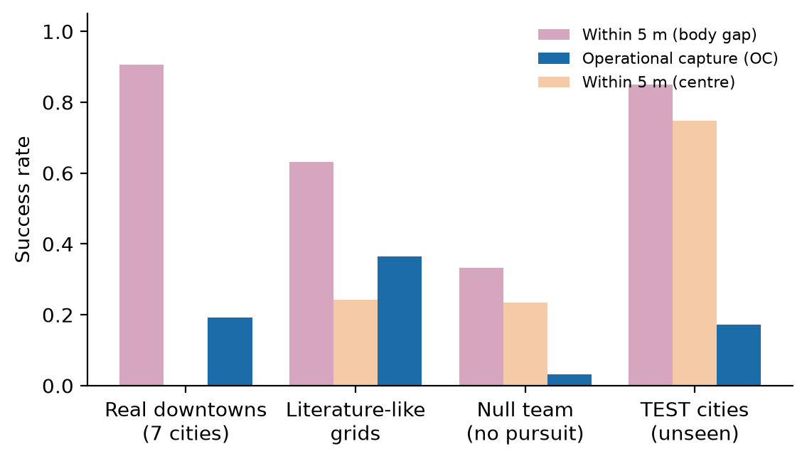

# When proximity is not interception

**Code, evidence and reproduction instructions for the article "When Proximity Is Not Interception: Auditing Capture
Endpoints and Predictive Lane Blocking for Vehicle Pursuit in Microscopic Urban Traffic Simulation"**
(A. Noguera Gil, F. Martinez-Rios, E. Avalos-Gauna).

The research in one page, with animations and charts: <https://andnog.github.io/pursuit-capture-audit/>
(`make serve` shows it locally.)

Multi-vehicle pursuit is commonly scored by proximity: an episode is a success when a pursuer comes within a few
metres of the evader. In microscopic urban traffic that rule is also met by two cars that pass each other in
opposite lanes. This repository holds an audit of what such endpoints measure, in the SUMO simulator on fifteen real
downtown networks, and everything needed to check it.



## What the study found

| Finding | Evidence |
|---|---|
| **Proximity is not interception.** A team that does not pursue scores 2–3 % under operational capture and 21–42 % under proximity endpoints. On two held-out sets of four cities, a 5 m rule reports three to five times more successes than an operational stop. | 548 + 4 498 episodes |
| In the official environments of two published methods, none of 3 379 capture events joined two vehicles in the same lane, and a team that turns at random met the published success criterion in 31–59 % of episodes, against 2–11 % for a team that chases. | released code, run unmodified |
| The endpoint changes the conclusion: a 12-point advantage of one controller over another vanishes under the 5 m body-gap rule and reverses under the centre-distance rule. | three independent sets of scenarios |
| **Containment indicators need auditing.** A junction-level indicator lets 72–82 % of the evaders that it certifies escape; a lane-level indicator, about 8 %. | 1 098 + 848 firings |
| **Waiting ahead beats chasing.** Predictive lane blocking minus pursuit is +0.145 [0.086, 0.207] on one held-out set of four cities and +0.064 [0.015, 0.114] on a second (97.5 % intervals, one evaluation each). Removing joint assignment costs 7.1 points. | single-shot, frozen methods |
| The operational endpoint is fallible too: it held in all 1 433 audited captures with the pursuers stopped, and an active lane-change probe released 15. | hold audit with complete follow-up |

Everything here is simulation with scripted evaders, in one simulator. The article states the limits in full.

## What is in this repository

Two layers, kept apart on purpose.

```
pursuit-capture-audit/
├── src/pursuit_audit/     the library: clean, typed, documented, tested
│   ├── domain/            vehicle bodies and traces
│   ├── endpoints/         operational capture (Specification) and proximity rules (Strategy)
│   ├── controllers/       decision kernels of the pursuit controllers
│   ├── statistics/        family-clustered bootstrap and paired contrasts
│   ├── evidence/          sealed packages and the catalogue of studies
│   └── reporting/         headline results recomputed from raw records
├── tests/                 unit tests and equivalence tests against the frozen code
├── as_run/                the frozen layer: exactly what produced the results
│   ├── src/ scripts/ tests/      the code as it ran
│   ├── experiments/              90 sealed evidence packages, with checksums
│   ├── governance/ contracts/ protocols/   registration records and amendments
│   ├── assets/                   the road networks (© OpenStreetMap contributors, ODbL)
│   └── provenance/               source archives and the count of simulations
├── results/               figures, the table of every number of the article, the evidence map
├── docs/                  the web site: one static page, its data written from the sealed evidence
├── REPRODUCE.md           how to verify, recompute and run every study again
└── tools/                 scripts that maintain this repository
```

**`as_run/` is the evidence.** It is a copy of the research project in its own layout, so that every script runs
from it unchanged. It is not reformatted or refactored: a cleaned-up copy would no longer be the code that produced
the numbers.

**`src/pursuit_audit/` is the code to read and to reuse.** It implements the endpoints, the statistics and the
decision kernels of the controllers again, with tests that compare it with the frozen code: the capture rule on
thousands of random situations, and the confidence intervals of the article to the last stored digit.

## Quick start

No simulator is needed for any of this. Python 3.10 or later and [uv](https://docs.astral.sh/uv/).

```bash
git clone https://github.com/Andnog/pursuit-capture-audit.git
cd pursuit-capture-audit
uv sync

uv run pursuit-audit verify       # every sealed file against its checksum
uv run pursuit-audit recompute    # headline results, from the per-episode records
uv run pursuit-audit score as_run/audit_kit/examples/*.jsonl
uv run pytest                     # unit and equivalence tests
```

`score` prints one line per trace. The three examples show the point of the exercise:

| Trace | What happens | Operational capture | Body gap ≤ 5 m | Front distance ≤ 5 m |
|---|---|---|---|---|
| `blocked_stop` | the evader stops 1 m behind a stopped pursuer and stays | yes, at 5.0 s | yes | no |
| `passing_cars` | two cars pass in opposite lanes at 12 m/s | no | yes | yes |
| `follower_behind` | the pursuer trails the evader at 10 m/s | no | yes | no |

## Score your own study

```python
import pursuit_audit as pa

frames = pa.load_trace("episode.jsonl")            # one frame per line, at a constant step
row = pa.score_trace(frames, evader="e1")           # every endpoint, one flat dictionary
capture = pa.operational_capture(frames, evader="e1")
print(capture.captured, capture.capture_time_s, capture.closest_failure)
```

A trace gives, for every vehicle and instant, the body centre (or the front bumper), the heading, the speed and the
body dimensions; see [`src/pursuit_audit/domain/trace.py`](src/pursuit_audit/domain/trace.py). Every threshold of
the operational rule is a parameter (`CaptureParameters`), and a new distance for a proximity rule is one call to
`register_distance`.

The article closes with a checklist of six things that a pursuit study can report at low cost: the capture rule in
full; the score of a team that does not pursue; a hold audit; the escape share of any containment indicator; a
held-out evaluation opened once; and which analyses were registered before the runs.

## Reproduce

[`REPRODUCE.md`](REPRODUCE.md) gives the commands. In short, four levels:

| Level | What it shows | Needs | Time |
|---|---|---|---|
| 0. Verify | the evidence is the sealed one | Python | seconds |
| 1. Recompute | the numbers of the article follow from the sealed records | Python | a minute |
| 2. Replay | sealed episodes come out the same in the simulator | SUMO 1.21 | minutes |
| 3. Run again | a study, from scratch, with its registered protocol | SUMO 1.21 | hours to days |

## Results

- [`results/ARTICLE_NUMBERS.md`](results/ARTICLE_NUMBERS.md): every number of the article that is checked against
  the sealed summaries (113), regenerated by `make numbers`.
- [`results/EVIDENCE_MAP.md`](results/EVIDENCE_MAP.md): for every claim, the package, the file and the key that hold
  it, and the amendments that registered and reported it.
- [`results/STUDIES.md`](results/STUDIES.md): the 90 sealed studies, with the script and the command of each.
- [`results/figures/`](results/figures/): the figures of the article, drawn by a script from the sealed files.

## The data archive

The packages in `as_run/experiments/` hold the protocols, the per-episode records, the summaries and the checksums.
Their heavy files (run logs, pickled training states and animations: 137 files, 552 MB) are in the data archive,
and [`as_run/SNAPSHOT.json`](as_run/SNAPSHOT.json) lists each one with its size and its sealed checksum.

> Data archive: DOI to be added when the deposit is made.

## How this was made

Two AI models were used in the research process, under the supervision of the first author, and the article
declares it. Claude Opus 5.5 (Anthropic) wrote and edited the code, ran the experiments and produced the figures
from the sealed result files. Astra (OpenAI) helped the first author and his advisor to check the work in six
rounds of audit, which found defects in the training code that were corrected and are reported. The safeguards are
in this repository: more than 500 unit tests, sealed packages with checksums, a script that checks every number of
the text against the sealed summaries, and a registration record with every amendment
([`as_run/governance/AMENDMENTS_EN.md`](as_run/governance/AMENDMENTS_EN.md)).

## Cite

See [`CITATION.cff`](CITATION.cff). The article has not been published yet; its reference will be added on
publication.

## Licences

Code: MIT ([`LICENSE`](LICENSE)). Results and documents: CC BY 4.0. Road networks derived from OpenStreetMap: ODbL,
© OpenStreetMap contributors. Details in [`LICENSE-DATA.md`](LICENSE-DATA.md). The released code of the two
published environments that were audited is not redistributed here; [`THIRD_PARTY.md`](THIRD_PARTY.md) gives their
addresses and the commits that were run.
