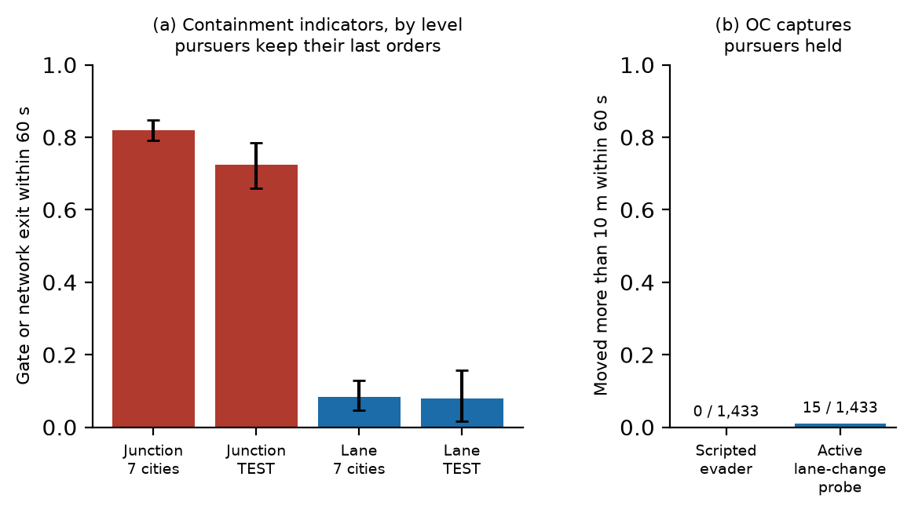

# Containment indicators need auditing

A containment indicator certifies, during an episode, that the evader is enclosed. It could serve as a stopping
rule or as a reward only if certified evaders in fact stay enclosed, so we measured how often they escape.

A search from the evader finds the junctions that it reaches before every pursuer, and the gates on their
frontier. An indicator fires when at most two such junctions remain and every gate has been held for 10 s:

- **junction level**: a pursuer is within 25 m of the gate, at no more than 2 m/s;
- **lane level**: every lane by which the evader would enter the gate carries a stopped pursuer ahead of the evader.

Each firing was simulated again with the pursuers keeping their last orders, for a complete 60 s. The evader
escapes if it enters an edge that leaves a gate, or leaves the network.

| Indicator | Cities | Certified evaders that escape | Firings |
|---|---|---|---|
| Junction level | seven of the development phase | 82.0 % [79.1, 84.8] | 1 098 |
| Junction level | TEST | 72.5 % [66.0, 78.5] | 848 |
| Lane level | seven of the development phase | 8.4 % [4.7, 12.9] | 225 |
| Lane level | TEST | 7.9 % [1.7, 15.8] | 240 |

The usual failure of the junction-level indicator is a pursuer parked on a different approach to the gate: near
the junction, and not in the evader's way. The lane-level indicator is useful and fallible.

An earlier analysis of ours counted escapes through gates only and treated late certificates as complete. It
reported 5.4–5.8 % and passed a 10 % criterion, which the definition above does not reproduce. The correction is
part of the record.

The two panels of the figure use different definitions of escape and are not comparable bar to bar.
