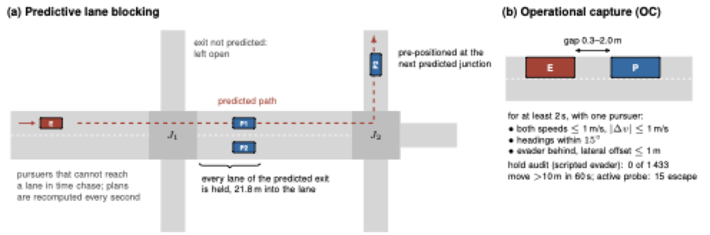
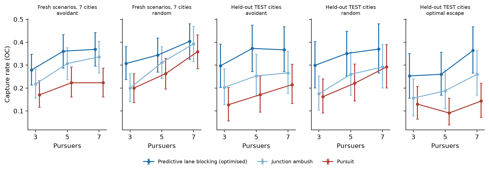
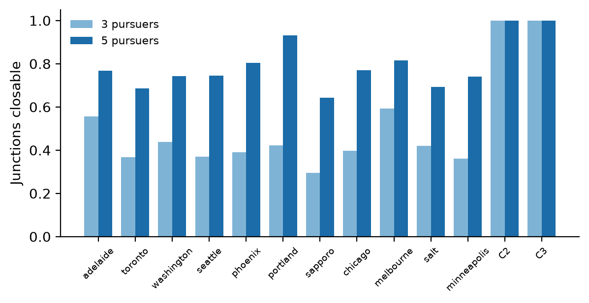

# Waiting ahead beats chasing

## Three controllers

*The schematic was drawn as vector code with the assistance of an AI model from the authors' description of the
method, and was reviewed by the authors.*

**Pursuit.** Every pursuer drives to the end of the evader's current edge.

**Junction ambush.** The planner predicts the evader's path: at each junction, the continuation that maximizes its
time lead over the nearest pursuer. For a junction \(J\) on that path, with exit lanes \(\mathcal{L}(J)\), predicted
arrival \(t_e(J)\) of the evader and estimated arrival \(c(i,\ell)\) of pursuer \(i\) at lane \(\ell\), the team
closes \(J\) when it has enough pursuers and the best assignment \(\pi\) of pursuers to lanes leaves enough slack:

\[
\max_{\pi}\; \min_{\ell \in \mathcal{L}(J)} \bigl[\, t_e(J) - c(\pi(\ell), \ell) \,\bigr] \;\ge\; m
\]

**Predictive lane blocking (PLB)** adds pre-positioning: when a full ambush is not feasible, pursuers wait in the
predicted exit lanes of the next one or two junctions. They decide in a fixed order; each takes the best lane that
it can reach in time and excludes the lanes already taken by teammates. Those that can reach no lane chase.

Getting ahead of an evader is not new: prepositioning at chokepoints is established in fugitive interception. PLB
is a baseline evaluated under an audited endpoint, not a new principle.

The decision kernels are in the library (`pursuit_audit.controllers`), tested against the code that ran.

## Two held-out sets, each evaluated once

Eleven cities were split before any experiment; four of them, TEST, were opened once, with frozen methods. A second
held-out set of four cities was registered before any of its maps was downloaded, and was also evaluated once.

**TEST**: operational capture rate by evader and team size.

--8<-- "generated/test_by_team.md"

**HELD-OUT B**

--8<-- "generated/heldout_b_by_team.md"

The registered primary is PLB minus pursuit, pooled over the avoidant and random evaders and all team sizes:

| | TEST | HELD-OUT B |
|---|---|---|
| PLB minus pursuit | +0.145 | +0.064 |
| 97.5 % interval over families | [0.086, 0.207] | [0.015, 0.114] |
| 95 % interval over cities and families | [0.074, 0.228] | [0.009, 0.132] |
| against the optimal evader | +0.171 [0.108, 0.238] | +0.073 [0.017, 0.131] |
| PLB minus junction ambush | +0.102 [0.053, 0.151] | +0.024 [−0.017, 0.064] |

The primary is met on both sets, and the advantage on the second is less than half of that on the first. The
difference is positive in all eight held-out cities, with an interval above zero in four of them. The improvement
of PLB over the simpler junction ambush, seen on TEST and on the development cities, was not reproduced on the
second set. We did not identify why the sets differ, and we report them side by side without pooling them, as
registered.

## Against other evaders

On the seven cities of the development phase, PLB minus pursuit is +0.105 [0.068, 0.141] against the avoidant and
random evaders, +0.214 [0.149, 0.279] against the optimal evader, and +0.105 [0.058, 0.156] against a goal-directed
fugitive, which is not of the kind that the predictor assumes. Against an evader whose decision weights were
searched to minimize capture by PLB itself, it is +0.128 [0.081, 0.178].

## Does coordination matter?

A registered ablation keeps the same prediction, information and per-pursuer rule, and removes joint assignment:
no team ambush, and each pursuer chooses its lane as if alone.

| Subset | Coordinated minus independent |
|---|---|
| All (0.349 against 0.278) | +0.071 [0.054, 0.089] |
| Avoidant evader | +0.081 [0.053, 0.113] |
| Random evader | +0.062 [0.035, 0.092] |
| Goal-directed evader | +0.070 [0.040, 0.103] |
| Teams of 3, 5 and 7 | +0.050, +0.078, +0.085 |

The ablation removes two decisions together, the team ambush and the exclusion of lanes taken by teammates; the
7.1 points measure that bundle, not either decision alone.

## What limits capture

Closing a junction needs a median of 3 to 4 lanes on real downtowns. A team of three can close 30–59 % of
junctions, against all of them on the grids of the literature. On TEST, capture by PLB falls from 0.43 when at most
four lanes must be closed at the evader's first junction to 0.12 when at least seven must. This is an association,
not an identified causal ceiling.
